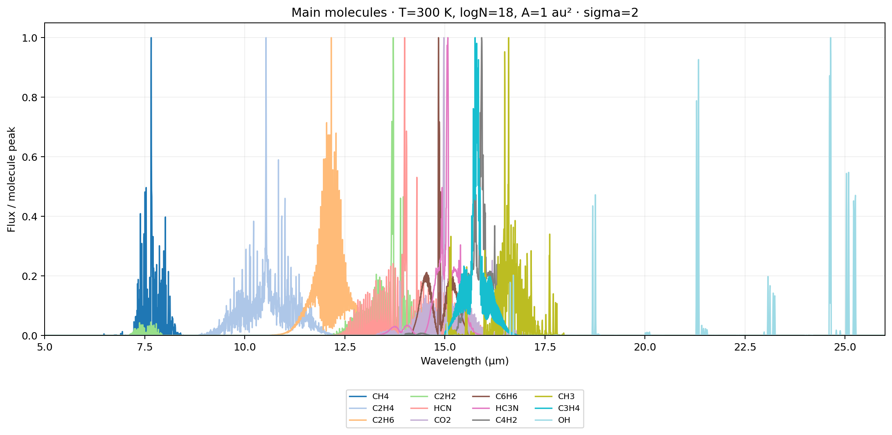
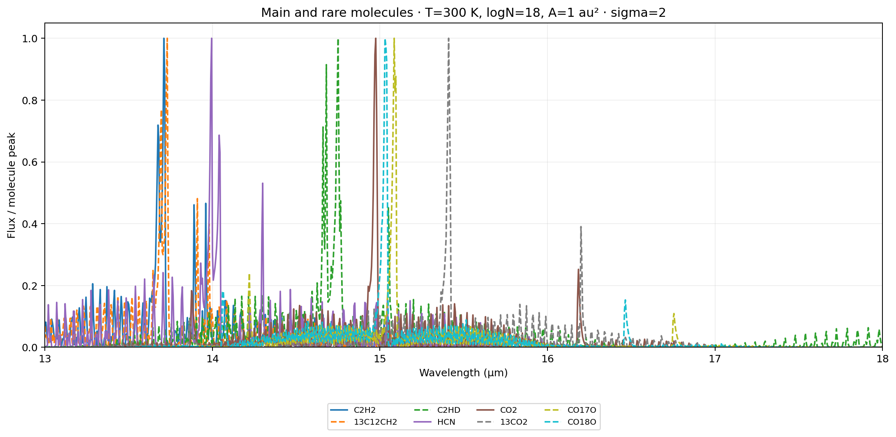

# Generate a molecular spectrum

The bundled forward models generate a spectrum from temperature $T$, column
density $\log_{10}N$, and emitting area $A$. No local model grids are needed.
For example, generate HCN in two lines:

```python
from diskmelts import synthesize_spectrum
wave, flux = synthesize_spectrum('HCN', T=300, logN=18, A=1)
```

`wave` is in µm and `flux` is in Jy. Here `logN=18` means
$N=10^{18}\,\mathrm{cm}^{-2}$, `A=1` means 1 au², and the default distance is
140 pc. For another distance or broadening grid, pass `distance_pc=122.5` or
`sigma=2`. To generate flux on your own wavelength axis, pass
`wavelength=your_wave`. The function returns that axis and the corresponding
flux. Keep $T$ and $\log_{10}N$ within the selected checkpoint's trained bounds.

The two-line helper is currently in the source checkout. With the published
2.2.0 package, the same HCN spectrum takes four lines:

```python
from diskmelts import load_fitting_models, generate_spectrum
model = load_fitting_models('HCN')['HCN']
wave = model['wav']
flux = generate_spectrum(300, 18, 1, model)
```

The runnable {doc}`spectrum generation notebook <notebooks/Example_Generate_Spectra>`
loads models once and plots every bundled molecule except water. Its default
uses `sigma=2`. The two-line `synthesize_spectrum` helper and this notebook
are in the current source checkout; they have not yet been published to PyPI.
Change `GRID_SIGMA` to 0 to use the matching sigma=0 models.
The spectra below use $T=300$ K, $\log_{10}N=18$, $A=1$ au², and 140 pc.
Each curve is an independent model with the **same illustrative** column
density and area; these plots do not represent a physical mixture or observed
isotopic ratios. For these figures, each spectrum is divided by its own peak
within the plotted wavelength range and displayed on a linear axis. This
shows where each molecule emits most strongly; curve heights do not compare
absolute brightness between molecules. The notebook retains the original
flux arrays in Jy.

## Main molecules, 5–26 µm

This includes CH4, C2H4, C2H6, C2H2, HCN, CO2, C6H6, HC3N, C4H2, CH3,
C3H4, and OH.



## Main molecules and rarer isotopologues, 13–18 µm

The zoom shows C2H2, HCN, and CO2 together with 13C12CH2 and C2HD (C2H2
family) and 13CO2, CO17O, and CO18O (CO2 family). No rarer HCN model is
bundled. Solid lines indicate the three main molecules; dashed lines indicate
rarer isotopologues.



See {doc}`Your first spectrum <quickstart>` to fit generated or observed arrays.
