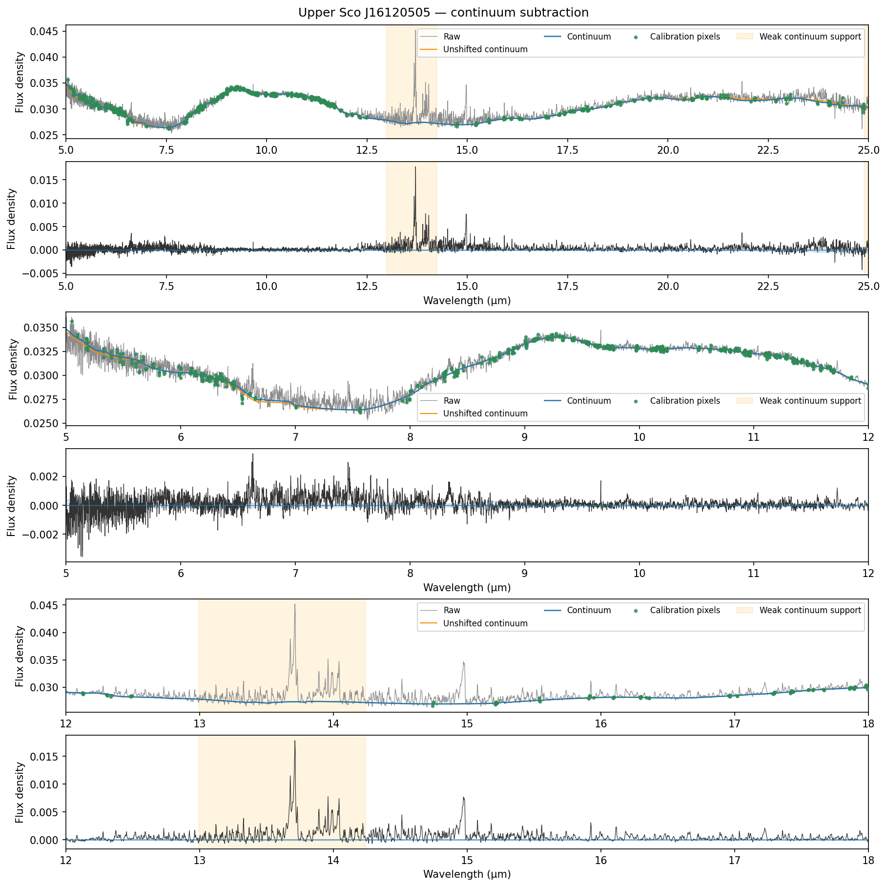
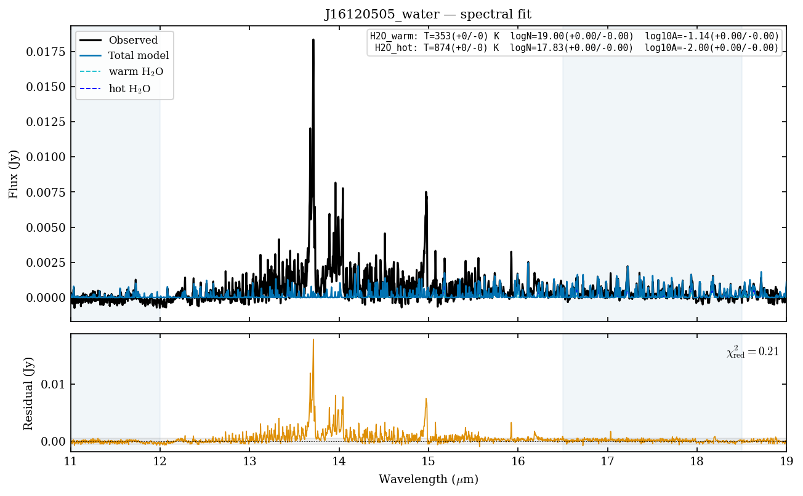
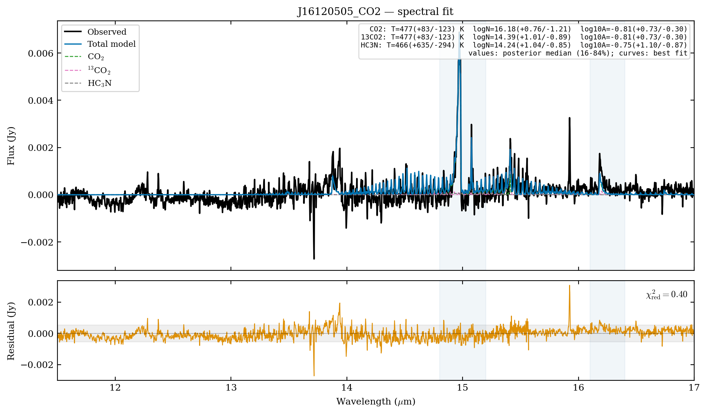

# Notebook tutorials

These pages display the maintained notebooks from the repository's
[`notebooks/`](https://github.com/wddlx/DiskMELTS/tree/main/notebooks) directory.
Clone the repository and run them with the `diskmelts-notebooks` environment
from {doc}`../installation`. The documentation build displays their code but
does not run the fitting or training cells. The figures below were rendered
from the included Upper Sco example and the notebook's current constrained
fitting run.

The fitting and training notebooks load checkpoints containing scikit-learn
1.8.0 objects. The repository's notebook Conda environment pins that version.
If you use another Python 3.11+ environment, run
`python -m pip install scikit-learn==1.8.0` in it and restart its notebook
kernel before loading the checkpoints. This avoids an unsupported
cross-version unpickle.

## 1. Subtract the continuum

{doc}`Example_Consub` reads the raw J16120505 CSV, estimates the continuum,
and plots the residual. Green points are pixels used to calibrate the
continuum correction. Orange shading flags weak support from those pixels.
The notebook currently sets `exclude=None`; setting an `exclude` interval adds
light red shading where those wavelengths are omitted from fitting.



## 2. Fit molecular emission

{doc}`Example_Fitting` fits water, carbon molecules, and CO₂ in sequence. In
the carbon stage, 13C12CH2 has at most the fitted temperature of C2H2 and
shares its emitting area. In the CO₂ stage, 13CO2 shares both values with CO₂. HCN, HC3N, and
the column densities remain independent. The plots below come from the
notebook's updated J16120505 fit.

The notebook uses the original sigma=0 checkpoints. To try the version 2.2.0
sigma=2 models in your own fit, load them with
`load_fitting_models(['H2O', 'C2H2'], sigma=2)`, or pass `sigma=2` to
`fit_observation`. The latter selects the corresponding checkpoints for all
stages. The {doc}`../quickstart` lists the available molecules and wavelength
bands; keep each fitting window inside its trained band.






These figures demonstrate the requested constraints. The hot-water and HC3N
areas reach their configured bounds in this example, so their individual
parameters need further review before scientific interpretation.

## 3. Train and validate a model

{doc}`Example_Training_Validation` shows how to load a bundled checkpoint and,
if you have complete local slab grids, opt into training and validation. The
packaged fitting and continuum tutorials do not require those grids.

```{toctree}
:maxdepth: 1
:caption: Notebooks

Example_Consub
Example_Fitting
Example_Training_Validation
```
