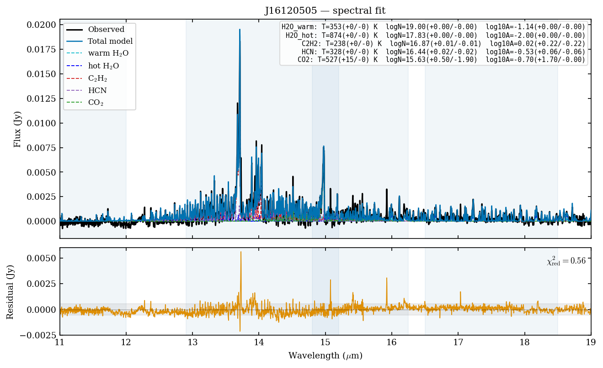

# Notebook tutorials

These pages display the maintained notebooks from the repository's
[`notebooks/`](https://github.com/wddlx/DiskMELTS/tree/main/notebooks) directory.
Clone the repository and run them with the `diskmelts-notebooks` environment
from {doc}`../installation`. The documentation build displays their code but
does not run the fitting or training cells. The figures below were rendered
from the included Upper Sco example and saved fitting results.

## 1. Subtract the continuum

{doc}`Example_Consub` reads the raw J16120505 CSV, estimates the continuum,
and plots the residual. Green points are pixels used to calibrate the
continuum correction. Orange shading flags weak support from those pixels.
The notebook currently sets `exclude=None`; setting an `exclude` interval adds
light red shading where those wavelengths are omitted from fitting.


## 2. Fit molecular emission

{doc}`Example_Fitting` fits water, carbon molecules, and CO₂ in sequence. The
water-stage plot shows its two components; the combined plot shows all fitted
components and the final residual. They were rendered from the notebook's
saved J16120505 results, without rerunning the fit.




## 3. Train and validate a model

{doc}`Example_Training_Validation` shows how to load a bundled checkpoint and,
if you have complete local slab grids, opt into training and validation. The
packaged fitting and continuum tutorials do not require those grids.

```{toctree}
:maxdepth: 1
:caption: Notebooks

Example_Consub
Example_Fitting
Example_Training_Validation
```
