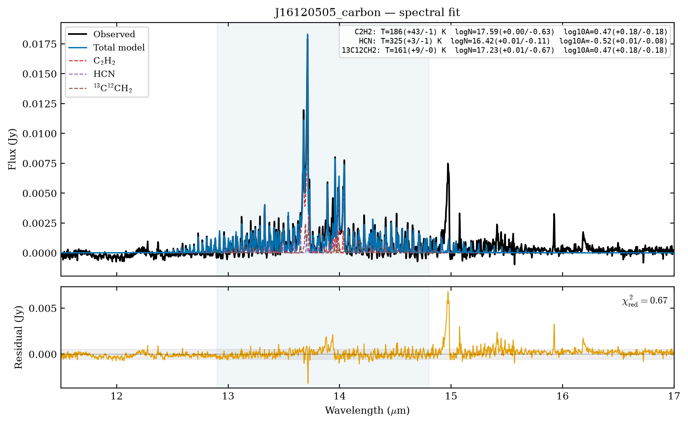

# Quick Start: subtract the continuum, then fit

Install with `python -m pip install diskmelts`. You can fit your own
continuum-subtracted spectrum without a repository checkout. For a sample,
download the
[J16120505 continuum-subtracted CSV](https://github.com/wddlx/DiskMELTS/blob/main/Realobs_data/Consub_data/j16120505_v9.0_contsub_RVcorr.csv)
as `j16120505_contsub.csv`, or use:

```bash
curl -L -o j16120505_contsub.csv https://raw.githubusercontent.com/wddlx/DiskMELTS/main/Realobs_data/Consub_data/j16120505_v9.0_contsub_RVcorr.csv
```

The CSV reader uses the first two columns for wavelength (µm) and flux (Jy)
and skips one header row. The sample's extra `err` and `cont` columns are fine.

## Step 1: prepare the spectrum

Start with the {doc}`continuum subtraction guide <continuum>` or
{doc}`Example_Consub <notebooks/Example_Consub>` when your spectrum still
contains its continuum. For your own input CSV with `wave,flux,err` columns:

```python
from diskmelts import consub

raw_wave, raw_flux, raw_error = consub.read_spectrum('my_raw_spectrum.csv')
wave, flux, error, continuum, baseline = consub.calculate(
    raw_wave, raw_flux, raw_error, preset='ttauri',
)
```

The resulting `wave` and continuum-subtracted `flux` can be passed directly
to `fit_stage`. The returned `error` is a measurement/noise estimate; it does
not include correlated continuum uncertainty.

If your spectrum is already continuum-subtracted, load it instead. This line
uses the downloaded sample; change the path for your own CSV:

```python
from diskmelts import load_observed_spectrum
wave, flux = load_observed_spectrum('j16120505_contsub.csv')
```

## Step 2: fit one molecule

The installed package includes the production v2 checkpoints. Fitting needs
no local model grids or training tables. Run this after either Step 1 path;
supply your source distance in parsecs when using your own spectrum:

```python
from diskmelts import load_fitting_models, fit_stage

models = load_fitting_models('C2H2')
fit = fit_stage(
    wave, flux,
    molecule='C2H2',
    wavelength_range=(13.0, 15.0),
    fit_ranges=(13.5, 14.1),
    pretrained=models,
    distance_pc=122.5,
    n_samples=1024, n_refine=4, n_top=4,
)
print(fit['params']['C2H2'])
```

`fit_stage` returns fitted parameters, component spectra, the total model,
residuals, and uncertainty estimates. It accepts one molecule or a list for a
joint fit. `fit_ranges` accepts one `(low, high)` pair, a list of pairs, or a
molecule-to-ranges mapping. Every fit interval must lie within
`wavelength_range` and inside each selected checkpoint's trained domain.
`MODEL_SPECS` records each checkpoint's wavelength, temperature, column-density,
PCA, and network settings; the loader verifies them. Only requested models are
loaded.

## Isotopologue temperature and area constraints

Fit the main and rare isotopologues in the **same stage**. The first label
in each `isotopologue_groups` entry is the main species. `Tshare` and `Ashare`
have one entry per group:

```python
models = load_fitting_models(['C2H2', '13C12CH2'])
fit = fit_stage(
    wave, flux,
    molecule=['C2H2', '13C12CH2'],
    wavelength_range=(11.5, 17.0),
    fit_ranges=(12.9, 16.25),
    pretrained=models,
    isotopologue_groups=[('C2H2', '13C12CH2')],
    Tshare=['equal'], Ashare=[True],
    T_bounds={'C2H2': (300, 900), '13C12CH2': (300, 900)},
    logN_bounds={'C2H2': (14, 19), '13C12CH2': (13, 18)},
    loga_bounds=(-2, 2),
    distance_pc=140.0,
)
```

`Tshare='equal'` fits one temperature for a group. `Tshare='less'` enforces
each rare species' temperature to be no greater than the main species'
temperature; it does not order the rare species among themselves.
`Tshare='free'` leaves their temperatures independent. These modes appear in
a list, such as `Tshare=['less', 'equal']` for two groups. `Ashare=[True]`
fits one emitting area for the group; `False` leaves areas independent.
Column densities remain independent in every mode.

The same three keys work in a `fit_observation` stage. Each group needs a main
and at least one distinct rare component; groups cannot overlap. Incompatible
temperature bounds raise an error. `T_bounds`, `logN_bounds`, and
`loga_bounds` may differ by component label or molecule; a tuple applies to
every component. For a shared-area group, the allowed areas must overlap. If
detection screening removes a group member, use `detection_screening=False`
or omit that group. The older `shared_area_groups` option still ties areas
without specifying a temperature relationship. No constraint spans separate
stages, because each stage fits the preceding residual.

To fit two components of the same molecule together, repeat its name in
`mol`, assign unique `component_names`, and key bounds by those labels. This
works in both `fit_observation` and `fit_observation_grids` stages:

```python
acetylene_stage = {
    'name': 'acetylene',
    'mol': ['C2H2', 'C2H2'],
    'component_names': ['C2H2_thin', 'C2H2_thick'],
    'wavelength_range': (12.9, 14.8),
    'fit_ranges': (12.9, 14.8),
    'T_bounds': (100, 1400),
    'logN_bounds': {'C2H2_thin': (13, 18), 'C2H2_thick': (19, 22)},
    'loga_bounds': {'C2H2_thin': (-4, 2), 'C2H2_thick': (-2, 4)},
}
```

Set `detection_screening=False` when you require both components regardless
of the detection screen. Direct-grid fits also require grid files covering
the full requested T and logN rectangle.

## Ordered stages, saved results, and plots

```python
from pathlib import Path
from diskmelts import fit_observation, plot_saved_observation

# This configuration follows notebooks/Example_Fitting.ipynb (J16120505).
source = Path('Realobs_data/Consub_data/j16120505_v9.0_contsub_RVcorr.csv')
stages = [
    {
        'name': 'water', 'mol': 'H2O',
        'wavelength_range': (11.0, 19.0),
        'fit_ranges': [(11.0, 12.0), (16.5, 18.5)],
        'h2o_components': 2,
        'component_names': ['H2O_warm', 'H2O_hot'],
        'T_bounds': {'H2O_warm': (200, 600), 'H2O_hot': (600, 1100)},
    },
    {
        'name': 'carbon', 'mol': ['C2H2', 'HCN', '13C12CH2'],
        'wavelength_range': (11.5, 17.0),
        'fit_ranges': (12.9, 14.8),
        'isotopologue_groups': [('C2H2', '13C12CH2')],
        'Tshare': ['less'], 'Ashare': [True],
    },
    {
        'name': 'CO2', 'mol': ['CO2', '13CO2', 'HC3N'],
        'wavelength_range': (11.5, 17.0),
        'fit_ranges': [(14.8, 15.2), (16.1, 16.4)],
        'isotopologue_groups': [('CO2', '13CO2')],
        'Tshare': ['equal'], 'Ashare': [True],
    },
]
output = Path('realobs_results/notebook_v2_tied/J16120505')
result = fit_observation(
    source, stages, name='J16120505', output_dir=output,
    distance_pc=122.5, detection_screening=False,
    n_samples=4096, n_refine=12, n_top=10, seed=42,
)
figures = plot_saved_observation(
    source, output, stages, name='J16120505',
    active_stages=result['fits'], sigma_noise=result['sigma_noise'],
    show=True, savefig=False,
)
```

The stages run in order. Each stage fits the previous stage's residual and
writes parameter, spectrum, and running-residual CSVs. The plotter checks the
saved subtraction sequence and creates stage and combined figures. It can be
called later without loading checkpoints or rerunning optimization. Set
`output_dir` explicitly; otherwise fit CSVs go under the current working
directory. Set `figure_dir` when saving figures. The source CSV may have a
header row; the default
reader skips one row and takes the first two columns as wavelength in µm and
flux in Jy. Override `skiprows`, `wav_col`, or `flux_col` if needed.

In a notebook, use `plot_saved_observation(..., show=True, savefig=False)`
to display each stage and combined figure inline without writing PNGs.
Set `savefig=True` to save them as well. With `savefig=False`, the returned
entries for the figures are Matplotlib Figure objects; otherwise they are
paths to the saved PNGs. The numeric plot-data CSV is written in either case.



This carbon-stage figure is from
{doc}`Example_Fitting <notebooks/Example_Fitting>`. Its parameter box shows
that 13C12CH2 is no hotter than C2H2 and shares its area; their
column densities differ. The lower panel shows the residual for that stage.

For the repository's J16120505 example, run
`python examples/dev_v2_realobs.py`. The example uses the packaged API.

## Distance and area

The checkpoints predict flux for `A=1 au²` at 140 pc. Supply the known source
distance using `distance_pc` (default 140). The fitted physical area scales as
`A * (140 / distance_pc)**2` in the observed flux. Distance and area cannot both
be measured from one spectrum because only `A / distance_pc**2` is constrained.
When `sigma` is supplied, the model fitter scales it with the flux to the
140 pc reference. Fitted uncertainties are optimization summaries; bound hits
and degeneracies require caution.

## Optional direct-grid fit

The separate grid API requires local slab CSVs. They are **not** included in
the package and are **not** consulted by model fitting.

```python
from diskmelts import fit_observation_grids, plot_saved_observation

grid_stages = [
    {key: value for key, value in stage.items()
     if key not in ('isotopologue_groups', 'Tshare', 'Ashare',
                    'shared_area_groups')}
    for stage in stages
]
result = fit_observation_grids(
    source, grid_stages, name='my_source',
    grid_root='Model_grids', output_dir='results/my_source_grids',
    distance_pc=122.5,
)
plot_saved_observation(
    source, 'results/my_source_grids', grid_stages, name='my_source',
    figure_dir='figures/my_source_grids', active_stages=result['fits'],
)
```

`Model_grids/<molecule>/T{temperature}N{log_column}.csv` must contain `wave`
and `Line` columns and cover the fitted domain. The grid fitter interpolates
between T/logN points, refines the best solutions, and adds the full local grid
step in quadrature to the formal T/logN errors. For example, a 25 K step gives
`T_total_sigma = sqrt(T_fit_sigma**2 + 25**2)` K. Its covariance describes
one local mode, not a full posterior. See {doc}`training` for obtaining and
using optional grids.
